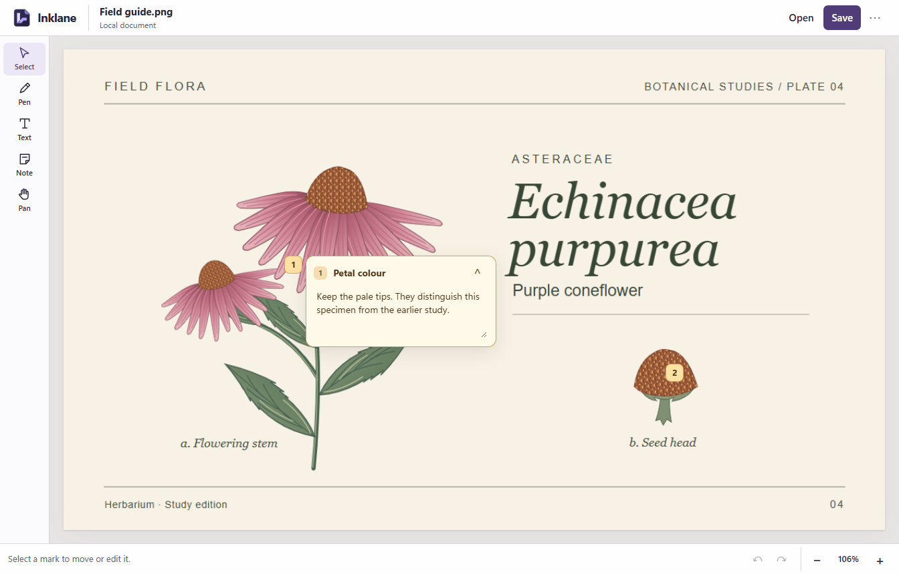
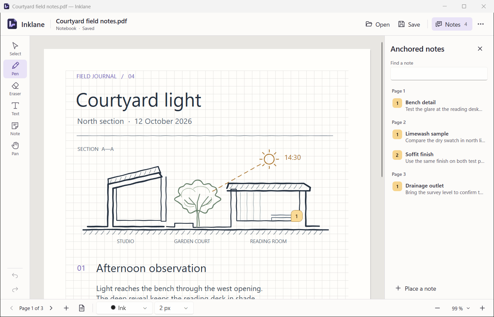
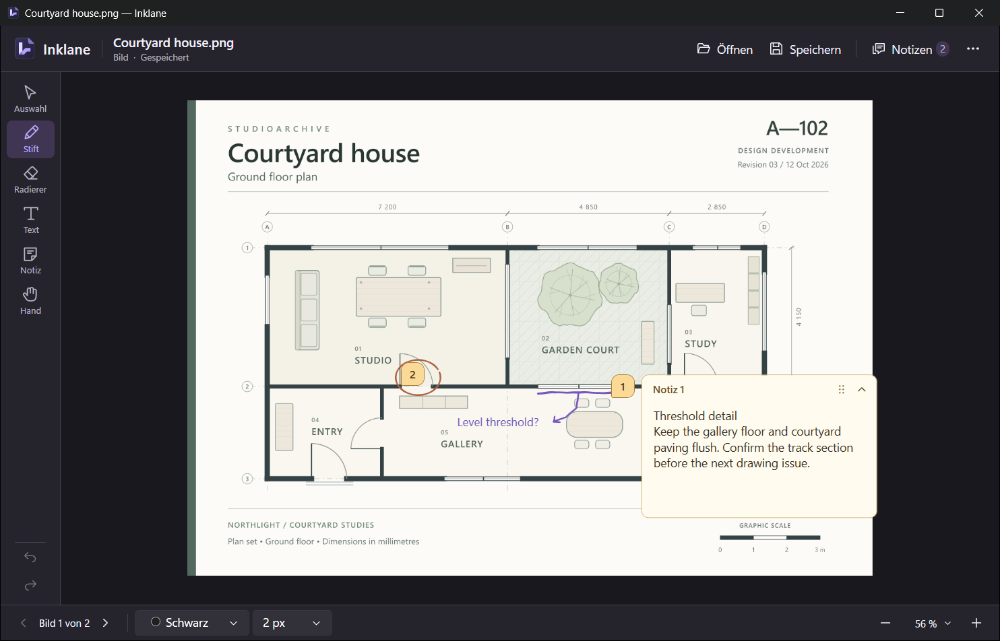

# Inklane

[Product website](https://dwolken.github.io/inklane/) · [Open the browser editor](https://dwolken.github.io/inklane/editor/) · [Windows downloads](https://github.com/dwolken/inklane/releases)

Inklane keeps feedback on the material it describes. Circle a detail, type a correction, or pin a longer explanation to its place on the page. Collapse the explanation to see the original again. [Try it on the field guide](https://dwolken.github.io/inklane/editor/?sample=review).

The [web workspace](https://dwolken.github.io/inklane/editor/) opens PDFs and images and creates printable notebooks without an account. The published Windows installer is **1.0.0-rc.2**; existing PDF review and Office review against a fixed PDF edition require the newer Windows source build.

[](https://dwolken.github.io/inklane/editor/?sample=review)

To start a review, open a document, choose **Pen**, **Text** or **Note**, and mark the page. Select a mark to move it; choose a note's number to edit its title or explanation. Save a portable copy to keep the original and the editable marks together, or export a feedback report for someone reviewing the same source.

## Install

Choose the **Inklane-Setup** x64 executable on the [Windows releases page](https://github.com/dwolken/inklane/releases). Run Setup and choose **Install**. Open **Inklane** from Start. The installer includes the .NET desktop runtime and installs for the current Windows user. Uninstall through **Settings → Apps → Installed apps**.

The candidate is unsigned. Windows may display the publisher as unknown. A portable ZIP and SHA-256 checksums are also available on the release page. For portable use, extract the complete folder and launch `Inklane.exe`.

The shared workspace can also be built as an offline [Android app](platforms/android/README.md), [macOS or iOS app](platforms/apple/README.md), or [Linux desktop package](platforms/linux/README.md). Each bundles the editor and renderer and uses the system file picker. These are development builds. There are no mobile store releases or published native installers for these platforms; the [web workspace](https://dwolken.github.io/inklane/editor/) is the immediately available option.

## Windows workspace



**Images.** Choose **Open an image** on Home. PNG and JPEG files open at a scale that shows the whole image. Use ← and → to browse other images in the folder. Click the image counter to jump to a filename. The list follows Explorer-style numeric order and updates when files are added or removed. Save writes the editable ink, text and notes to a neighboring `.inklane.json` file. Keep the image and its sidecar together. **More actions → Export annotated PNG** creates a separate image for sharing.



**Notebooks.** Choose **New notebook**, then select A4 or A5, orientation, and blank, ruled or squared paper. The live preview shows the result. Patterned paper supports 5 mm, 10 mm and custom spacing with adjustable margins. Click the notebook title to rename it. The title stays separate from the PDF filename and location. New pages inherit the current paper. Click the page counter to jump, or right-click it to duplicate, reorder or remove pages. These commands are also available under **More actions → Pages**. The initial writing view fills the available width up to 140%. Scroll down the sheet to continue writing. The zoom menu also offers full width, whole page and actual size.

**Anchored notes.** Choose **Note** and click a point on the document. Type in the card and collapse it to its number. Click the card heading to name it, or choose **Rename note** from its context menu. Unnamed notes keep their number. Use **Notes** in the header to search note titles and contents or return to an anchor. Reading a note leaves the saved state clean. An explicit save retains the card presentation alongside its text and location.

**Editing.** Pen draws with a mouse or supported Windows stylus. Select lets you lasso ink or move text and note handles. Text inserts or edits keyboard text. Eraser removes strokes. Pan moves the viewport. The footer shows color and size controls for the active writing tool. Home lists up to six recently opened or saved documents on this computer.

**Clipboard.** Right-click an object or use **More actions → Edit**. In Select, Ctrl+click to build a selection, or use Ctrl+A for the whole page. Copy and paste selected ink, text, pictures and notes between pages, images or Inklane windows. Click inside a text field to copy or paste just the selected words.

Paste a screenshot onto the current page, then move it in Select or resize it by its corner. From Home, Ctrl+V starts a notebook with the clipboard contents. For a flattened copy, choose **Copy annotated image** or **Copy page as image** in the Edit menu. **Copy original image** copies the source pixels without markup. Image saves continue to use a sidecar.

| Shortcut | Action |
| --- | --- |
| Ctrl+O / Ctrl+N | Open a file / create a notebook |
| Ctrl+S / Ctrl+Shift+S | Save / Save as |
| Ctrl+Z / Ctrl+Y | Undo / Redo |
| Ctrl+C / Ctrl+X / Ctrl+V | Copy / cut / paste |
| Ctrl+D / Ctrl+A / Delete | Duplicate / select all / delete selected objects |
| F2 / Esc | Edit selected text or a note title / finish editing or clear selection |
| Arrow keys / Shift+arrow | Nudge selected objects / larger step |
| Left / Right | Browse folder images when the canvas has no selection |
| Shift+F10 | Open the canvas context menu |
| Alt+Left / Alt+Right | Previous / next image or page |
| Ctrl+0 / Ctrl+1 | Fit page / fit width |
| Ctrl+wheel | Zoom about the pointer |
| P / V / E / T / N / H | Pen / Select / Eraser / Text / Note / Pan |
| Ctrl+P | Print |

Tool shortcuts apply outside text entry. Appearance follows Windows by default. **More actions** contains light/dark overrides, English/German language options, export and print. Language changes take effect on the next launch.

## Files and compatibility

**Review a PDF or Office document in the development build.** Open a PDF on Home and mark its pages. Save keeps your work next to the original as `filename.pdf.inklane.json`. Share both files with another Inklane user to continue editing. Export a marked page as PNG or print it to share its visible marks. A general PDF keeps its original pages, forms and annotations in the source file.

For DOCX or PPTX, open the Office file and choose its matching PDF export. With LibreOffice in a standard Windows installation folder, **Create PDF copy** can also render supported self-contained files locally. Use an export from Word or PowerPoint for layout-sensitive files or documents with links and fields. Pick a new PDF filename for each revision. Inklane remembers the file pair on this computer and checks both fingerprints when you reopen the Office file. Annotations stay with the reviewed page or slide.

**Share precise feedback.** In the browser editor or the RC.3 Windows build, choose **More actions → Export feedback**. Give the recipient the reviewed source and the resulting `.feedback.json`. The report records the source fingerprint, page, location, note text and ink geometry. It can be read by a script as well as by a person. [Feedback format and example](docs/feedback.md)

**Continue in the web workspace.** Open a PNG, JPEG or PDF, or start a notebook with blank, ruled or squared paper. A portable `.inklane` file keeps the editable marks together with the reviewed source. For a smaller transfer, keep the original and its matching `.inklane.json` sidecar together. Image sidecars work with Windows; PDF sidecars require the Windows source build. A feedback export describes the marks for a recipient and is independent of the editable save.

**Use it offline.** Open the web workspace once while online, then check **More → Offline access**. After it reports ready, it can reopen even when the server is unreachable, including its PDF renderer. Use a supported browser's install command to give the workspace its own window. Local drafts belong to that browser profile: keep a portable copy before clearing site data or changing devices.

**Take a notebook between editions.** The Windows source build can open a portable notebook from the web and save it as an editable PDF. To go the other way, use **Export portable notebook** in Windows. For an annotated image or an existing PDF, transfer the original and its matching JSON sidecar; Windows does not unpack source-backed web bundles.

A notebook PDF contains standard Ink, FreeText and Text annotations, vector paper, placed pictures, and an attached JSON model for editable reopening in Inklane. Other PDF readers can display the page and may expose annotation contents. Their note presentation varies. Editable notebook reopening includes the original alpha format released in November 2026. A title or placed image needs RC.2 or newer. General PDF markup uses a separate schema 3 sidecar and needs this development build. Inklane rejects detected external changes to protected notebook content. Keep third-party edits in a separate copy.

Normal saves use atomic replacement. Inklane checks image identity and detects conflicting file changes. Local recovery snapshots follow editing pauses. Documents, recovery files and recent paths stay on this computer. Settings and recovery live in `%LOCALAPPDATA%\Inklane`. Print uses the selected Windows driver with a 150 DPI raster at the document's physical dimensions.

## Build and verify

Use Windows x64, PowerShell 7 and the .NET SDK pinned in `global.json`. From the repository root:

```powershell
./scripts/build.ps1
dotnet run --project src/Inklane
./scripts/package.ps1
```

Packaging uses locked dependencies and a hash-pinned portable NSIS compiler. It builds the self-contained application, starts it, and writes an installer, ZIP and checksums in `artifacts/`. On a machine where Inklane has no registered installation, `./scripts/package.ps1 -VerifyInstaller` also exercises installation, upgrade, launch and removal. The check guards existing installations and test documents. Windows CI runs the release checks.

The [validation record](docs/validation.md) distinguishes actual desktop inspection, numerical checks and remaining device tests. See the [changelog](CHANGELOG.md), [architecture decisions](docs/architecture.md), and [dependency notices](THIRD-PARTY-NOTICES.md).
