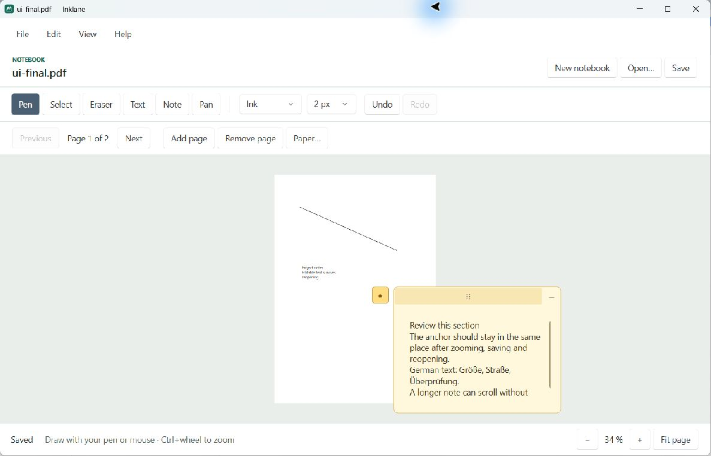

# Inklane

Inklane is a local Windows 11 application for image annotation and printable PDF notebooks. **0.1.0-alpha.1** is an unsigned evaluation build, not a production release. The repository is private.



Actual Windows application at full-page fit. New notebook pages initially open at a larger editing scale.

## Workspaces

- **Images:** open PNG/JPEG files, browse their folder in one window, fit/zoom/pan, draw with a mouse or Windows stylus, add editable text and anchored notes, select/move/erase content, and undo/redo. Save creates a neighboring `image.png.inklane.json` sidecar; the source image stays unchanged. Annotated PNG and JSON export are available.
- **Notebooks:** A4/A5 portrait or landscape, blank/ruled/squared paper, 5 mm and 10 mm spacing or custom 1–100 mm spacing, adjustable margins, multiple pages, and the same editing tools. Save writes a PDF that can be reopened in Inklane with supported annotations still editable.
- **Notes:** a small marker expands into an editable, scrolling card. Card text stays readable at different zoom levels; the anchor remains in document coordinates. PDF notes contain their full text as standard annotations.
- **Document safety:** unsaved-change decisions, cancelable switching, atomic writes, original-image fingerprints, changed-file conflict protection, bounded undo history, and local recovery snapshots after edits.
- **Windows integration:** native file/print dialogs, keyboard shortcuts, DPI-aware layout, system/light/dark appearance, Windows display-language selection with German and English fallback. Appearance and language overrides are under View; a language change applies on restart.

## Run the Windows build

Download the ZIP from [private releases](https://github.com/dwolken/inklane/releases) or a successful [Windows Actions run](https://github.com/dwolken/inklane/actions). Extract **the whole folder**, then launch `Inklane.exe`. No separate .NET installation or administrator privileges are required. Windows may identify the executable as unsigned; no code-signing certificate or installer is included. The app does not register file associations or install a background service.

Keep image files and their `.inklane.json` sidecars together. When moving both, open the image so Inklane can find its neighboring sidecar. A notebook PDF carries its own editable data and does not require a sidecar.

## Editing

Choose Pen, Select, Eraser, Text, Note, or Pan. Text and Note insert at the clicked location. Use Text or Select to edit existing text; note markers open and close their cards. In Select mode, drag around ink to select it, drag an object's handle to move it, or press Delete. Ctrl+mouse wheel zooms, and Fit page returns to a full-page view. New pages inherit the current paper settings.

| Shortcut | Action |
| --- | --- |
| Ctrl+N / Ctrl+O | New notebook / Open |
| Ctrl+S / Ctrl+Shift+S | Save / Save as |
| Ctrl+Z / Ctrl+Y | Undo / Redo |
| Ctrl+P | Windows print dialog |
| Ctrl+0 / Ctrl+plus / Ctrl+minus | Fit / Zoom in / Zoom out |
| Alt+Left / Alt+Right | Previous / Next image or page |
| P / V / E / T / N / H | Pen / Select / Eraser / Text / Note / Pan, when not typing |

Use the matching paper size and orientation in the print dialog. The print path rasterizes at 150 DPI and uses the document's physical dimensions. Printer drivers and printable margins can affect physical output. PDF output retains vector paper and ink appearances.

## PDF interoperability and limits

Notebook PDFs contain standard Ink, FreeText and Text annotations with appearance streams, plus versioned JSON for Inklane editing. Other PDF programs can view the file and may expose its annotation contents; they do not reproduce Inklane's note cards or necessarily support every annotation. Note cards are represented by markers in exported/printed output, with full text retained in PDF/JSON data.

This alpha reopens **Inklane-created notebooks**. General PDF import/editing is unsupported. Externally changed PDF content is rejected when its fingerprint no longer matches; changes are not merged. Keep third-party-edited copies separate. Informational PDF metadata is not preserved when Inklane regenerates a notebook.

Physical pen pressure, tablet-specific behavior, physical printer output, Narrator, and mixed-monitor DPI transitions still need device validation. Automated pressure rendering and UI mouse input are tested separately. There is no handwriting recognition, touch-gesture guarantee, installer, auto-update, or code signing.

Document safeguards include 1,000 pages, two million ink points, 32 MiB editable JSON, 128 MiB PDFs, and 100-megapixel/256 MiB images. Large documents are processed locally and may take time to save. Undo history is bounded. Recovery snapshots are best effort, normally written two seconds after editing pauses; they supplement explicit saving and cannot guarantee the last edit survives power loss.

Settings, recovery snapshots and diagnostic errors are stored in `%LOCALAPPDATA%\Inklane`. The app contains no network service, telemetry, or cloud synchronization. Local files may still be synchronized by a folder service chosen outside Inklane.

## Develop and verify

Requirements: Windows 11 x64, PowerShell 7, and the .NET SDK pinned in `global.json` (10.0.402). From the repository root:

```powershell
./scripts/build.ps1
dotnet run --project src/Inklane
./scripts/package.ps1
```

The build uses locked NuGet restores and runs executable persistence, WPF surface, and document-lifecycle regression suites. Packaging builds into an isolated `.scratch/` directory, publishes the self-contained runtime, launches the packaged executable for a real window/render check, verifies the runtime was loaded from the package, and creates a ZIP plus SHA-256 under `artifacts/`.

GitHub Actions repeats these checks on Windows. Version tags create a prerelease only after the package passes and the workflow confirms the repository is private. Local development uses the `github-private` SSH identity; verify the GitHub CLI account independently before using it.

See [validation evidence](docs/validation.md), [architecture and format decisions](docs/architecture.md), and [third-party notices](THIRD-PARTY-NOTICES.md). PDFsharp-WPF 6.2.4 is pinned under MIT; upstream has ended updates for this branch and changed later releases' licensing. Upgrading requires an explicit maintenance/licensing review. No open-source license is granted for Inklane itself.
